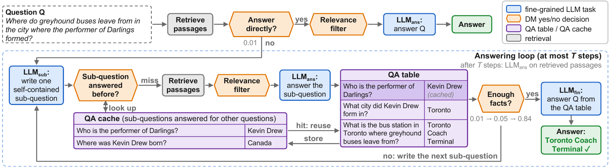

# DeFT-RAG

**Decomposing Multi-Hop Questions into Self-Contained Sub-Questions with Reusable Answers**

Dingyi Kang and Bingzhe Li, University of Texas at Dallas

**Paper:** [arXiv:2610.37826](https://arxiv.org/abs/2610.37826)

<p align="center">
  
</p>

*Overview of DeFT-RAG on an example question. The LLM performs only three fine-grained tasks (blue): writing one self-contained sub-question, answering a question from retrieved passages, and answering the original question from the QA table. A fine-tuned decision model (DM) makes every decision (orange). The QA table, updated by rules, holds the QA pairs found for the question; the QA cache holds those found for other questions, so the first sub-question here is answered from the cache without retrieval or an LLM call.*

## Overview

DeFT-RAG is a retrieval-augmented generation (RAG) framework for multi-hop question answering. Multi-hop questions require chaining facts spread across several documents through intermediate entities that the question never mentions. DeFT-RAG is built on three components:

1. **Incremental decomposition into self-contained sub-questions.** The LLM generates one sub-question at a time from the original question and the sub-questions answered so far with their answers (*QA pairs*), until these QA pairs are enough to answer the original question. Each sub-question names every entity it asks about and does not depend on the answer to any other sub-question, so nothing has to be planned in advance, no dependencies are tracked, and no sub-question is ever rewritten.
2. **Fine-grained tasks outside the LLM.** A QA table, updated by rules, keeps track of what is known, and a lightweight fine-tuned decision model (DM) makes the decisions: which retrieved passages are relevant, whether a question's passages contain everything needed to answer it, how many hops the question needs (estimated from the question alone), and whether the QA pairs found are enough. A question is answered directly when its passages are sufficient and it needs at most two hops. The LLM only writes sub-questions and answers questions, each from a short input.
3. **QA cache.** Because a self-contained sub-question has the same meaning whichever question it was written for, its answer is cached and reused when a later question asks a sub-question with the same meaning, which saves retrieval and LLM calls.

## Results

1,000 questions per benchmark (the test sets of the LogicRAG release), two backbones, thirteen baselines. **Acc** is LLM-judged accuracy, our main metric: gpt-4o-mini runs are judged by Qwen3.6 and Qwen3.6 runs by gpt-4o-mini, so no model grades its own answers. EM and F1 are computed from the answers as given and understate systems that answer in full sentences, such as LightRAG with gpt-4o-mini. Best in **bold**, second best <u>underlined</u>.

**gpt-4o-mini backbone**

| System | MuSiQue EM | F1 | Acc | 2Wiki EM | F1 | Acc | HotpotQA EM | F1 | Acc | Avg EM | F1 | Acc |
|---|---:|---:|---:|---:|---:|---:|---:|---:|---:|---:|---:|---:|
| No Retrieval | 0.122 | 0.226 | 0.239 | 0.273 | 0.351 | 0.410 | 0.268 | 0.397 | 0.527 | 0.221 | 0.325 | 0.392 |
| Vanilla RAG | 0.238 | 0.347 | 0.412 | 0.459 | 0.553 | 0.659 | 0.468 | 0.619 | 0.799 | 0.388 | 0.506 | 0.623 |
| LightRAG | 0.000 | 0.087 | 0.305 | 0.000 | 0.150 | 0.505 | 0.000 | 0.190 | 0.696 | 0.000 | 0.142 | 0.502 |
| PathRAG | 0.123 | 0.233 | 0.276 | 0.278 | 0.379 | 0.451 | 0.397 | 0.549 | 0.693 | 0.266 | 0.387 | 0.473 |
| HippoRAG | 0.189 | 0.286 | 0.323 | 0.461 | 0.550 | 0.650 | 0.389 | 0.515 | 0.676 | 0.346 | 0.450 | 0.550 |
| HippoRAG 2 | 0.303 | 0.428 | 0.478 | 0.558 | 0.639 | 0.713 | 0.546 | 0.691 | 0.813 | 0.469 | 0.586 | 0.668 |
| MemGraphRAG | 0.275 | 0.398 | 0.453 | 0.524 | 0.576 | 0.635 | 0.514 | 0.665 | 0.795 | 0.438 | 0.546 | 0.628 |
| G3RAG | 0.327 | 0.450 | 0.503 | 0.542 | 0.611 | 0.682 | 0.563 | 0.711 | 0.830 | 0.477 | 0.590 | 0.672 |
| LinearRAG | 0.243 | 0.375 | 0.439 | 0.450 | 0.611 | 0.786 | 0.439 | 0.625 | 0.822 | 0.377 | 0.537 | 0.682 |
| LogicRAG | 0.333 | 0.459 | 0.495 | 0.586 | 0.694 | 0.772 | 0.559 | 0.688 | 0.798 | 0.493 | 0.614 | 0.688 |
| IRCoT | 0.348 | 0.465 | 0.510 | 0.619 | 0.701 | 0.767 | 0.595 | 0.721 | 0.823 | 0.521 | 0.629 | 0.700 |
| Self-Ask | 0.339 | 0.455 | 0.500 | 0.589 | 0.695 | <u>0.849</u> | 0.451 | 0.596 | 0.783 | 0.460 | 0.582 | 0.711 |
| Hi-Q | <u>0.414</u> | <u>0.549</u> | <u>0.577</u> | <u>0.631</u> | <u>0.720</u> | 0.812 | <u>0.600</u> | <u>0.734</u> | <u>0.840</u> | <u>0.548</u> | <u>0.667</u> | <u>0.743</u> |
| **DeFT-RAG (ours)** | **0.453** | **0.587** | **0.629** | **0.678** | **0.767** | **0.852** | **0.627** | **0.775** | **0.874** | **0.586** | **0.709** | **0.785** |

**Qwen3.6-35B-A3B backbone**

| System | MuSiQue EM | F1 | Acc | 2Wiki EM | F1 | Acc | HotpotQA EM | F1 | Acc | Avg EM | F1 | Acc |
|---|---:|---:|---:|---:|---:|---:|---:|---:|---:|---:|---:|---:|
| No Retrieval | 0.128 | 0.216 | 0.198 | 0.366 | 0.417 | 0.428 | 0.293 | 0.392 | 0.427 | 0.262 | 0.341 | 0.351 |
| Vanilla RAG | 0.297 | 0.373 | 0.397 | 0.553 | 0.618 | 0.670 | 0.604 | 0.726 | 0.809 | 0.485 | 0.572 | 0.625 |
| LightRAG | 0.270 | 0.385 | 0.459 | 0.367 | 0.493 | 0.688 | 0.400 | 0.598 | 0.816 | 0.346 | 0.492 | 0.654 |
| PathRAG | 0.333 | 0.439 | 0.444 | 0.524 | 0.607 | 0.667 | 0.599 | 0.727 | 0.813 | 0.485 | 0.591 | 0.641 |
| HippoRAG | 0.187 | 0.247 | 0.257 | 0.535 | 0.604 | 0.676 | 0.453 | 0.554 | 0.621 | 0.392 | 0.468 | 0.518 |
| HippoRAG 2 | 0.346 | 0.439 | 0.471 | 0.625 | 0.682 | 0.744 | 0.604 | 0.727 | 0.818 | 0.525 | 0.616 | 0.678 |
| MemGraphRAG | 0.265 | 0.340 | 0.388 | 0.537 | 0.576 | 0.621 | 0.542 | 0.654 | 0.740 | 0.448 | 0.524 | 0.583 |
| G3RAG | 0.411 | 0.501 | 0.534 | 0.622 | 0.679 | 0.725 | 0.633 | 0.752 | 0.839 | 0.555 | 0.644 | 0.699 |
| LinearRAG | 0.353 | 0.437 | 0.475 | 0.671 | 0.758 | 0.830 | 0.606 | 0.746 | 0.857 | 0.543 | 0.647 | 0.721 |
| LogicRAG | 0.391 | 0.503 | 0.529 | <u>0.696</u> | <u>0.779</u> | <u>0.838</u> | 0.620 | 0.745 | 0.830 | 0.569 | 0.675 | 0.732 |
| IRCoT | 0.383 | 0.482 | 0.486 | 0.678 | 0.747 | 0.799 | 0.629 | 0.761 | 0.843 | 0.563 | 0.663 | 0.709 |
| Self-Ask | 0.423 | 0.526 | 0.546 | 0.677 | 0.762 | 0.825 | 0.581 | 0.708 | 0.795 | 0.560 | 0.665 | 0.722 |
| Hi-Q | <u>0.466</u> | <u>0.574</u> | <u>0.583</u> | 0.600 | 0.681 | 0.783 | <u>0.652</u> | <u>0.776</u> | <u>0.864</u> | <u>0.573</u> | <u>0.677</u> | <u>0.743</u> |
| **DeFT-RAG (ours)** | **0.494** | **0.615** | **0.636** | **0.716** | **0.801** | **0.867** | **0.658** | **0.799** | **0.871** | **0.623** | **0.738** | **0.791** |


DeFT-RAG also gives the LLM fewer input tokens per question than any other iterative method (1,569, against 1,926 to 13,928 with gpt-4o-mini). With a QA cache shared across the 1,000 MuSiQue questions, 23.1% of sub-questions are answered from the cache, which reduces LLM calls by 12.9% without lowering accuracy (0.642 with reuse vs. 0.629 without). See the paper for the analyses and ablations.

## Repository layout

```
deftrag/
  loop.py            the method: prompts, decision-model requests, the answering loop (solve)
  retriever.py       dense retrieval (Qwen3-Embedding-4B), exactly as used for the paper
  cache.py           the QA cache (exact match, then nearest stored sub-questions + same-question decision)
  make_questions.py  builds the paper's question files from the LogicRAG release
  run_eval.py        runs DeFT-RAG on a question file; resumable, one JSON line per question
  to_bench.py        converts a run to the grading format
  grade.py           LLM-judged accuracy (the paper's judge prompt and settings)
  em_f1.py           exact match and token F1
decision_model/      builds the fine-tuning data of the decision model (training splits only)
assets/              the overview figure
```

All prompts are in `deftrag/loop.py` and are exactly the strings used for the results in the paper (they are also listed in its appendix). The prompts call the QA pairs "facts".

## Reproducing the results

### 1. Install

Python 3.10+ and a GPU. One GPU with about 20 GB of free memory runs the decision model; the embedder needs about 8 GB more (it is spread across GPUs if needed); a local Qwen3.6 backbone needs its own GPU memory.

```bash
git clone https://github.com/Dingyi-Kang/DeFT-RAG.git && cd DeFT-RAG
pip install -r requirements.txt
```

### 2. Data

We use the corpora and 1,000-question test sets released with [LogicRAG](https://github.com/chensyCN/LogicRAG) (Chen et al., 2026), the same files as every baseline in the paper.

```bash
git clone https://github.com/chensyCN/LogicRAG.git
export LOGICRAG_DIR=$PWD/LogicRAG
python deftrag/make_questions.py questions      # questions/{musique,2wikimultihopqa,hotpotqa}.json
```

The question files have the same ids, question text, gold answers and order as in the paper. The corpus embeddings are computed on the first run (about 27,600 passages in total) and cached in `emb_cache/` (set `DEFTRAG_EMB_CACHE` to change it).

### 3. The decision model

Our fine-tuned decision model is on Hugging Face: [Dingy-Kang/DeFT-RAG-DM-4B](https://huggingface.co/Dingy-Kang/DeFT-RAG-DM-4B). It is served with the server of the StartLux-Decision release, which comes with the base model:

```bash
huggingface-cli download startlux-models/StartLux-Decision-4B --local-dir StartLux-Decision-4B   # the server code
huggingface-cli download Dingy-Kang/DeFT-RAG-DM-4B --local-dir DeFT-RAG-DM-4B                   # our model
pip install -r StartLux-Decision-4B/requirements.txt
cd StartLux-Decision-4B && python -m startlux_decision.server --model ../DeFT-RAG-DM-4B \
    --port 8090 --no-images --max-length 16384 --name deftrag-dm &
cd ..
```

DeFT-RAG reaches it at `http://localhost:8090/v1/systemone` with the request format it was trained for; these are the defaults, so no setting is needed.

### 4. The backbone LLM

Any OpenAI-compatible chat-completions endpoint, at temperature 0.

```bash
# Qwen3.6-35B-A3B on a local Ollama server (the default)
ollama pull qwen3.6:35b-a3b-q8_0
export DEFTRAG_LLM=qwen3.6:35b-a3b-q8_0 DEFTRAG_LLM_URL=http://localhost:11434/v1/chat/completions

# or gpt-4o-mini
export DEFTRAG_LLM=gpt-4o-mini DEFTRAG_LLM_URL=https://<endpoint>/v1/chat/completions DEFTRAG_LLM_KEY=<key>
```

### 5. Run

```bash
python deftrag/run_eval.py musique         questions/musique.json         runs/musique.jsonl
python deftrag/run_eval.py 2wikimultihopqa questions/2wikimultihopqa.json runs/2wiki.jsonl
python deftrag/run_eval.py hotpotqa        questions/hotpotqa.json        runs/hotpotqa.jsonl
```

Each line of the output holds a question's answer and its full trace (sub-questions, QA pairs, decisions, calls and tokens). Runs are resumable: rerunning the same command skips finished questions. A question takes about 10 seconds (median, with gpt-4o-mini), most of it in decision-model calls.

### 6. Grade

```bash
python deftrag/to_bench.py runs/musique.jsonl runs/musique_bench.json
python deftrag/em_f1.py runs/musique_bench.json                                   # EM and F1

# Acc, judged by the other backbone: Qwen3.6 (Ollama) for gpt-4o-mini runs ...
python deftrag/grade.py --api ollama --judge qwen3.6:35b-a3b-q8_0 --url http://localhost:11434 \
    runs/musique_bench.json runs/musique_graded.json
# ... and gpt-4o-mini for Qwen3.6 runs
python deftrag/grade.py --api openai --judge gpt-4o-mini --url https://<endpoint>/v1 --key <key> \
    runs/musique_bench.json runs/musique_graded.json
```

`grade.py` sends the same request as for every system in the paper: SimpleQA's grading criteria with the question, gold answer and prediction, temperature 0, top-p 1, seed 42, a 16-token verdict, and Qwen3.6's reasoning turned off.

### 7. QA cache (answer reuse)

All main results are obtained without reuse. To answer the questions in order with one shared cache:

```bash
DEFTRAG_REUSE=1 DEFTRAG_CACHE_DIR=caches/musique python deftrag/run_eval.py musique questions/musique.json runs/musique_reuse.jsonl
```

**Expect small differences.** The gpt-4o-mini API does not return identical outputs on every call even at temperature 0, and GPU kernels can change low-order digits of the embeddings and probabilities, so a rerun can differ from the paper by a few questions.

## Settings

| Setting | Value |
|---|---|
| Retrieval window *w* (retry and fallback) | 10 (20) |
| Step limit *T* | 6 |
| Relevance: keep if p(yes) ≥ | 0.5 |
| Passages kept when one / none pass | 2 / 5 |
| Passages kept at most | 5 |
| Direct answer: sufficient ≥ | 0.7 |
| Direct answer: estimated lookups ≤ | 2 |
| Enough facts: p(yes) ≥ | 0.5 |
| Reuse: stored sub-questions compared | 5 |
| Reuse: same meaning p(yes) ≥ | 0.8 |
| Passage length cap (characters) | 3,000 |

These are the defaults in `deftrag/loop.py`. The rules in `DEFTRAG_FIXES` (see the top of `loop.py`) are on by default and identical for every benchmark and backbone.

## Fine-tuning the decision model

All labels come from the gold annotations of the **training** splits of MuSiQue, 2WikiMultiHopQA and HotpotQA; no test question, test passage or test-corpus paragraph is used.

1. Build the relevance, direct-answer, lookup and enough-facts items (training questions in groups of 1,000, each group's own passages as its corpus, top-10 retrieval with DeFT-RAG's embedder): `decision_model/build_ft_data.py`.
2. Add the 2Wiki sub-question and enough-facts items: `decision_model/build_2wiki_loop.py`.
3. Collect realistic enough-facts states by running DeFT-RAG on training-split questions (`decision_model/make_train_runs.py`, then `deftrag/run_eval.py` with `DEFTRAG_CORPUS` set to the training corpus), and label them: `decision_model/build_realgap.py`.
4. Select the rows (about half of the questions; gold plus three random non-gold relevance targets per request): `decision_model/select_rows.py`.
5. Train with the LoRA scripts of the StartLux-Decision release: 1 epoch from StartLux-Decision-4B, LoRA rank 16, alpha 32, dropout 0.05 on all attention and MLP projections, peak learning rate 1e-4, micro-batches of 8,192 tokens, gradient checkpointing, gradient clipping at 1.0. Then fit one temperature per question type (yes/no, and the lookup estimate) on the training-split development examples.

The final data has 48,036 training and 7,806 development examples. Paths are set with the environment variables at the top of each script (`DEFTRAG_WORK`, `DEFTRAG_DATA`, `LOGICRAG_DIR`). The fine-tuned model is released on Hugging Face (see [Decision model](#3-the-decision-model)), so this step is needed only to rebuild it.

## Citation

```bibtex
@article{kang2026deftrag,
  title   = {{DeFT-RAG}: Decomposing Multi-Hop Questions into Self-Contained Sub-Questions with Reusable Answers},
  author  = {Kang, Dingyi and Li, Bingzhe},
  journal = {arXiv preprint arXiv:2610.37826},
  year    = {2026}
}
```

If you use the decision model, please also cite [StartLux-Decision](https://huggingface.co/startlux-models/StartLux-Decision-4B), from which it is fine-tuned.

## License

The code in this repository is released under the MIT License (see `LICENSE`). The fine-tuned decision model is derived from StartLux-Decision-4B and, like it, is licensed under CC BY-NC 4.0 (research and other non-commercial use only). The LogicRAG data are used under their own license.
